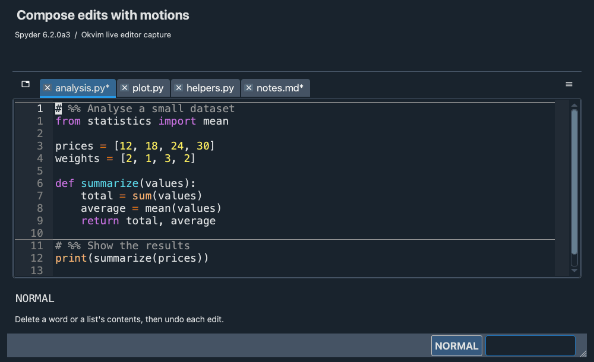
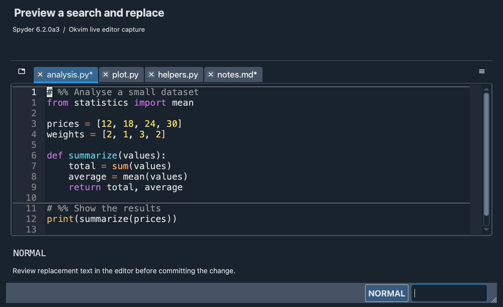
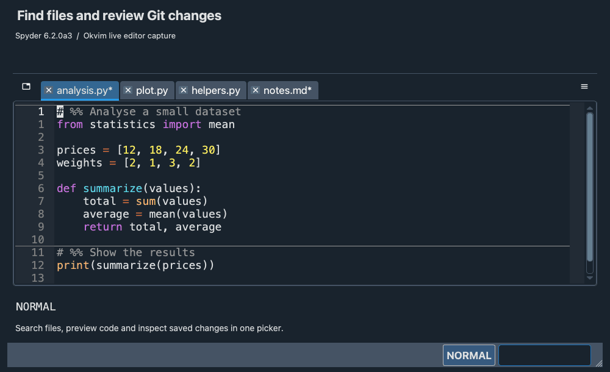

# Spyder Okvim

[](https://github.com/ok97465/spyder_okvim/actions/workflows/windows-tests.yml)
[](https://github.com/ok97465/spyder_okvim/actions/workflows/macos-tests.yml)
[](https://codecov.io/gh/ok97465/spyder_okvim)

Vim editing in Spyder, with code-cell commands, labelled jumps, search previews,
and a shared file/Git picker.

## Installation

Requires **Python 3.11+** and **Spyder 6.2.0a3+**. Install in the environment
that runs Spyder, then restart Spyder:

```bash
python -m pip install spyder-okvim
```

If `spyder-vim` is installed, remove it first with `python -m pip uninstall spyder-vim`
to avoid conflicts. For a local checkout, use `python -m pip install -U .`.

Press **Esc** in the editor to enter Normal mode. Use `i` to insert text,
`v` / `V` for Visual / Visual Line mode, and **Esc** to return to Normal mode.
The default **`<leader>` is Space**: `<leader>r` means Space, then `r`.

## Editing

Combine an operator with a motion or text object: `diw` deletes a word,
`ci"` changes text inside quotes, and `yip` copies a paragraph.
Counts work too: `d2w` deletes two words.

| Task | Keys |
| --- | --- |
| Insert / append; open a line below / above | `i` / `a`; `o` / `O` |
| Delete / change / copy | `d{motion}` / `c{motion}` / `y{motion}` |
| Delete / change / copy a whole line | `dd` / `cc` / `yy` |
| Paste after / before; browse yank history | `p` / `P`; `<leader>y` |
| Undo / redo; repeat the last change | `u` / `Ctrl+r`; `.` |
| Indent / unindent; reindent | `>>` / `<<`; `==`, `={motion}`, `gg=G` |
| Replace a character; join lines | `r{char}`; `J` / `gJ` (without spaces) |
| Lowercase / uppercase / swap case | `gu{motion}` / `gU{motion}` / `g~{motion}` |
| Add / change / remove surroundings | `ysiw"` / `cs"'` / `ds"` |
| Increment / decrement a number | `Ctrl+a` / `Ctrl+x` |

Text objects include words (`iw`, `aw`, `iW`, `aW`), paragraphs (`ip`, `ap`),
brackets and quotes (`i(`, `a{`, `i"`, etc.), and Spyder cells (`ic`).
Use `==` for indentation or `<leader>f` for Spyder's formatter.
After pasting, `Ctrl+p` / `Ctrl+n` cycle through yank history.
Record a macro with `q{register}` … `q` and replay it with `@{register}`
(experimental). [Surround examples](doc/usage.md#surround).



## Navigation

| Task | Keys |
| --- | --- |
| Move by character / word | `hjkl`; `w`, `W`, `b`, `e` |
| Line start / first nonblank / end | `0` / `^` / `$` |
| File start / end; go to a line | `gg` / `G`; `:{number}` |
| Scroll half / full page | `Ctrl+d` / `Ctrl+u`; `Ctrl+f` / `Ctrl+b` |
| Match a bracket; find a character | `%`; `f`, `F`, `t`, `T` |
| Repeat a character jump / reverse its direction | `;` / `,` |
| Center the cursor line / move it to the top / bottom | `zz` / `zt` / `zb` |
| Set a mark; return to a marked line / position | `m{letter}`; `'{letter}` / `` `{letter} `` |
| Go back / forward through jump history | `Ctrl+o` / `Ctrl+i` |

Uppercase marks persist across sessions.
[More about marks and jump history](doc/usage.md#marks-and-jump-history).

**Leap:** press `s`, type two target characters, then choose a label if shown.
For an operator, use `z` instead: `dz{two characters}`. Leap also works in
Visual mode and with `.` repeat.

**EasyMotion:** press `<leader><leader>` followed by `w` / `b` for words,
`j` / `k` for lines, or `f{char}` / `F{char}` for characters; then choose a
label. These motions also combine with operators.


## Search and replace

Search with `/pattern` or `?pattern`; use `n` to repeat and `N` to reverse direction.
Substitution shows a preview while you type; press **Enter** to apply or **Esc**
to cancel.

| Command | Result |
| --- | --- |
| `:s/foo/bar/` | Replace the first match on the current line |
| `:%s/foo/bar/g` | Replace all matches in the file |
| `:3,8s/foo/bar/g` | Replace within lines 3–8 |
| `:%s/foo/bar/gc` | Confirm each replacement |

Patterns use **Qt regular expressions**: `(group)` and `+`, rather than Vim's
`\(group\)` and `\+`. A substitution is one undo step.
[More substitution examples and confirmation keys](doc/usage.md#search-and-replace).



## Spyder integration

| Task | Keys |
| --- | --- |
| Run the selection / current line; run a cell and advance | `<leader>r`; `<leader>Enter` |
| Debug the current cell; debug selection / current line | `<leader>d`; `<leader>D` |
| Toggle a breakpoint; format document / selection | `<leader>b`; `<leader>f` |
| Toggle comments | `gcc`, `gc{motion}`, or `gc` in Visual mode |
| Previous / next cell; copy / delete / change a cell | `[c` / `]c`; `yic` / `dic` / `cic` |
| Previous / next warning or error | `[d` / `]d` |
| Go to definition; inspect an object | `gd`; `K` |
| Switch file / symbol; next / previous file | `<leader>p` / `<leader>s`; `gt` / `gT` |
| Split the editor; move between splits | `:vsplit`; `Ctrl+w`, then `h` / `j` / `k` / `l` |
| Save and close the current file | `ZZ` |

In Spyder's file and symbol switchers, use `Ctrl+n` / `Ctrl+p` to select results.
If Spyder intercepts `Ctrl+w` or the picker's `Ctrl+p`, reassign the conflicting
binding in **Preferences → Keyboard shortcuts**.

## Files and Git

The shared picker searches files, marks, jump history, and Git data with a code
or diff preview. Change sources in the same window.

| Source | Shortcut / command |
| --- | --- |
| Project files | `Ctrl+p` (when not cycling a paste) |
| Marks / jump history | `<leader>tm` / `<leader>tj`, or `:marks` / `:jumps` |
| Git status | `<leader>ts`, or `:gitstatus` |
| Repository / current-file commits | `<leader>tc` / `<leader>tC`, or `:gitlog` for the repository |
| Stashes / branches | `<leader>tS` / `<leader>tb` |

Type to filter, use `Ctrl+n` / `Ctrl+p` to select, and **Enter** to open the
selected item. **Esc** closes the picker. Git sources provide an **Actions** menu
for staging, committing, checkout, and other operations.
[Picker controls and Git actions](doc/usage.md#files-and-git-picker).



## Settings and support

Open **Preferences → spyder_okvim** to change the leader key, search case behavior,
Leap, yank history, key hints, command-line suggestions, and substitution preview.
Pause after a prefix such as `<leader>` or `g` to see available keys.

If something goes wrong, uninstall Okvim and check whether it still happens.
Report Okvim problems in the [Okvim issue tracker](https://github.com/ok97465/spyder_okvim/issues).
