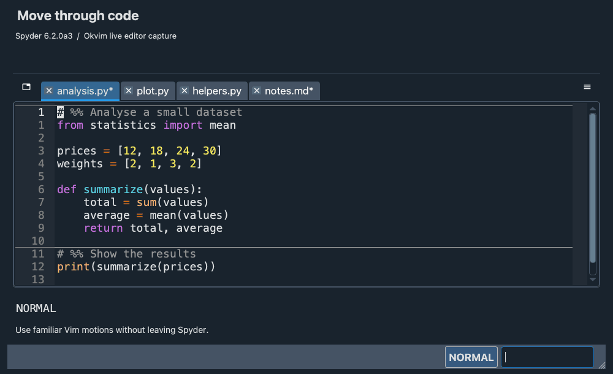
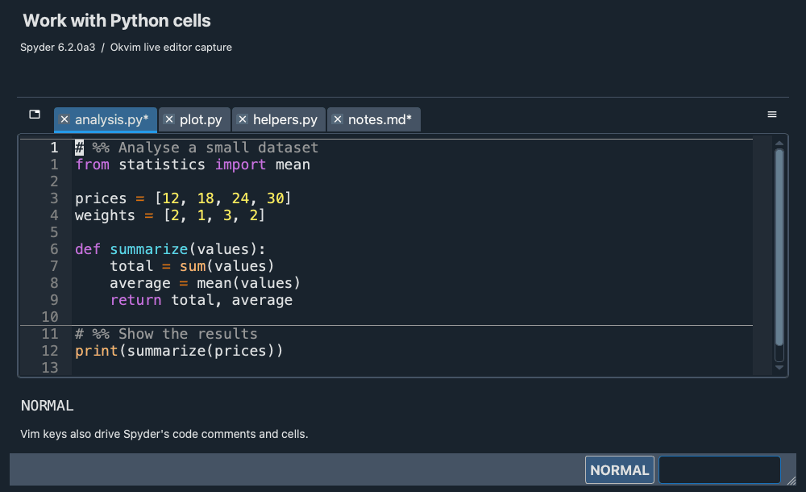
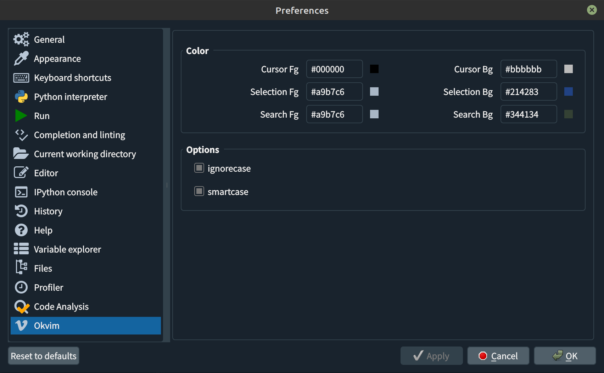

# Spyder Okvim

[](https://github.com/ok97465/spyder_okvim/actions/workflows/windows-tests.yml)
[](https://github.com/ok97465/spyder_okvim/actions/workflows/macos-tests.yml)
[](https://codecov.io/gh/ok97465/spyder_okvim)

Spyder plugin for running Vim commands in the code editor.

```text
Please do not open issues on the Spyder GitHub after installing Okvim.
```

If you run into problems, uninstall Okvim and try again.

## Overview

- Supported Vim motions include `hjkl`, `^u`, `%`, `iw`, `i(`, `/`, `?`, `n`, `N`, `;` and more.

- You can combine operators with motions. Examples: `diw`, `di(`, `c%`, `c/foo`, `cn`, `ygg`, `d2w`, `2d2W` and more.
  
- Spyder commands such as running a selection, formatting, and toggling comments are also available.

- Macro support is experimental.

| Movements | Combination | Spyder command |
|------|-------------|----------------|
| |  |  |


## Installation

You can install this plugin either directly from PyPI or locally.

### Install from PyPI

```bash
pip install spyder-okvim
```

### Install Locally

To install from a local copy:

```bash
pip install -U .
```

### Note

If **spyder-vim** is installed, uninstall it first to avoid conflicts:

```bash
pip uninstall spyder-vim
```

## Modes

The following modes are supported:

- Normal
- Visual
- Visual Line

## Actions

The following actions are supported:

- x, s, r
- C, D, S
- dd, cc, yy
- <<, >>
- ==, ={motion}, gg=G
- p, P
- d{motion}, c{motion}
- <{motion}, >{motion}
- gu{motion}, gU{motion} g~{motion}, ~
- u, ^R
- J, gJ
- .

Use `==` to reindent the current line, `3==` for three lines, `=j` for the
current and next line, or `gg=G` for the whole document. Reindent uses Spyder's
indentation rules and the active document's space/tab settings, changes only
leading whitespace, and supports undo and `.` repeat. Python dedents and
multiline string contents are preserved. Use `<leader>f` for full formatting.

## Motions

The following motions are supported:

- hjkl
- 0, ^, $
- w, W, b, e
- iw, iW, aw, aW, ip, ap
- i()[]{}bB, a()[]{}bB, i'", a'", and inner/around backticks
- G, g
- :{number}
- ^D, ^U, ^F, ^B
- HLM
- %
- [[, ]], {{, }}
- f, F, t, T, ;, ,
- /, ?, N, n
- Enter, Space, Backspace
- easymotion

## Mark

Use `m{mark}` to set a mark at the current cursor position and `'` or \` to jump back to it. Uppercase marks are saved in Spyder's configuration folder so they persist across sessions.

## Vim keys

- ^A : Add [count] to number
- ^X : Subtract [count] to number
- K : Inspect current object
- gd : Go to definition.
- gt, gT : Cycle to next/previous file.
- zz, zt, tb : Cursor line to some locations of screen.
- ZZ : Save and close current file.
- q, @: macro
- :marks: Searches marks with a code preview.
- :jumps: Searches jump history with a code preview.
- :gitstatus: Inspects staged and unstaged changes.
- :gitlog / :gitcommits: Browses existing commits and patches.
- :vs, :vsp, :vsplit: Splits the current editor into side-by-side views.
- Ctrl+w then h/j/k/l: Moves to the left/down/up/right editor split in Normal mode.
  Disable Spyder's Ctrl+w shortcut to use this sequence.

## Jump list

The jump list is a core Vim feature that tracks recently visited
locations. Okvim records each position so you can return with `Ctrl+o` and
move forward with `Ctrl+i`. Locations are added when opening files with
`Ctrl+p` and when running `gd`. Because Spyder's "go to definition" works
asynchronously, Okvim pushes the current location immediately and adds the
new one once navigation finishes. If the cursor never moves within two
seconds, that temporary entry is discarded.

## Special keys

- \<leader\>f : autoformat the curruent file
- \<leader\>b : toggle a breakpoint
- \<leader\>d : debug the current cell without advancing
- \<leader\>D : debug the selection or current line without advancing
- \<leader\>r : run the selection or current line in the console.
- \<leader\>enter :  run cell and advance
- \<leader\>p : Spyder switcher
- \<leader\>s : Spyder symbol switcher
- \<leader\>tm : Marks picker
- \<leader\>tj : Jumps picker
- \<leader\>ts : Git status and staged/unstaged patches
- \<leader\>tS : Git stash list and saved patches
- \<leader\>tc : Repository commit history
- \<leader\>tC : Current file commit history, following renames
- \<leader\>tb : Local and remote Git branches
- [d : go to previous warning/error
- ]d : go to next warning/error
- gc{motion} : toggle comments (works in visual mode)
  - gcc : toggle the comment for the current line
- [c, ]c : go to previousr/next cell
- yic, dic, cid : Operate on the entire current cell (yank, delete, or change respectively)

In either Spyder switcher, use `Ctrl+p` and `Ctrl+n` to select the previous
and next item while keeping focus in the search field.

The default leader key is Space. Press Space then `d` to debug a cell, or
Space then Shift+`d` to debug the visual selection (the current line when
nothing is selected).

## Search and replace

In search and Ex prompts, press Ctrl+r followed by a register name to insert its
text at the cursor or replace selected prompt text. For example, Ctrl+r then `a`
inserts register `a`, and Ctrl+r then `+` inserts the clipboard.

Use `:s` or `:substitute` to replace
matches in the current file. Each changing command is one undo step (`u`),
with redo through `Ctrl+r`.

| Command | Result |
| --- | --- |
| `:s/foo/bar/` | Replace the first match on the current line |
| `:%s/foo/bar/g` | Replace every match on every line |
| `:3,8s/foo/bar/g` | Replace within lines 3 through 8, inclusive |
| `:.,$s/foo/bar/g` | Replace from the current line through the last line |
| `:s#old/path#new/path#g` | Use an alternate delimiter |
| `:s/foo//g` | Delete matches |
| `:s/foo` | Delete the first match on the current line |
| `:s//bar/g` | Reuse the last confirmed search pattern |
| `:s/foo/bar/g 3` | Replace on the current line and the next two lines |
| `:%s/(foo)+/[\1]/g` | Use Qt capture groups and replacement references |
| `:%s/foo/bar/gn` | Count matches without changing text |
| `:%s/foo/bar/ge` | Replace all matches, allowing macros to continue if none are found |
| `:%s/foo/bar/gc` | Confirm each replacement |
| `:s` or `:&` | Repeat the last substitution on the current line, without flags |
| `:&&` | Repeat the last substitution, keeping its flags |
| `:~` | Use the latest search pattern with the previous replacement |

During confirmation, use `y` to replace, `n` to skip, `a` to replace all remaining
matches, `l` to replace once and stop, or `q`/Escape to stop. Approved changes
remain one undo step. `Ctrl+o` and `Ctrl+i` navigate between the substitution's
origin and destination. Confirmation cannot be replayed in macros, and Vim's
confirmation scrolling keys (`Ctrl+e`/`Ctrl+y`) are not supported.

Patterns use the same **Qt regular expressions** as `/` search, rather than
Vim's pattern syntax: use `(group)` and `+`, not `\(group\)` and `\+`.
Replacements support `&`, `\0`–`\9`, `\&`, `\\`, `\t` and `\b`; missing captures
expand to empty text and an unrecognized escape such as `\z` inserts `z`.
Line breaks, case conversion, expression replacements (`\=`), and previous
replacement expansion (`~` within replacement text) are not supported.
Use numeric, `.`, `$`, or `%` line addresses; relative, mark, and search
addresses are not supported. Unlike Vim, identical replacements do not add an
undo step. A plain `~` in a replacement is currently literal.

## Vim Surround

- Supported surroundings: '"()[]{}bB

The following actions are supported:

- ys{motion}{surroundings} in normal mode: add surroundings in pairs.
- ds{surroundings} in normal mode: delete surroundings in pairs.
- cs{surroundings}{surroundings} in normal mode: change surroundings in pairs.
- S{surroundings} in visual mode: add surroundings in pairs.

## Shared picker

Press **Ctrl+P** to search project files. `:marks` / `<leader>tm` and
`:jumps` / `<leader>tj` open the same window; the source selector switches
between Files, Marks, Jumps, Git status,
Git commits/log, Git stashes, current file commits, and Git branches. If Spyder intercepts
Ctrl+P, reassign its global binding.

Results appear on the left, with the best match beside the search prompt at the
bottom. The independent preview on the right follows the editor's theme and
shows unsaved open documents. Selecting a row, searching, or closing the picker
preserves the original document and navigation history.

| Key | Action |
| --- | --- |
| Ctrl+N/P, Down/Up | Next/previous result |
| Ctrl+F/B, PageDown/PageUp | Page through results |
| Ctrl+D/U | Scroll the preview; disabled when preview is hidden/unavailable |
| Enter / double click | Open a location, checkout a commit/branch, or apply a stash |
| Esc / Ctrl+C | Close |
| Ctrl+O/I in Jumps | Move through actual history immediately; Esc keeps that movement |

The picker starts at 80% of the parent width and 70% of its height. Refresh and
Preview have full-size click targets; narrow windows put the buttons on a second
row and stack the panels. The Preview button hides/shows preview.
Refresh recollects the current source. Query, selection and scroll are retained
per source and scope until the picker closes. Files retain the existing
`.py`, `.txt`, `.md` range, excluding hidden paths and symlinks. Collection,
search, content, and display limits are reported separately when reached.

Use `:gitstatus` to inspect separate unstaged and staged patches, including
staged-only changes. Untracked files show their contents. `:gitlog` (also
`:gitcommits`) browses existing commits; Ctrl+L lists changed files, and Back
restores the previous query and selection. Load more extends the loaded history
range. Root commits compare against an empty tree; merge commits compare against
the first parent. Disk/index diffs are labelled when an open buffer has unsaved
changes. The Actions menu lists the available Git operations and their keys.

The default Space leader adds these Telescope-style picker shortcuts:

| Shortcut | Picker |
| --- | --- |
| `<leader>tm` | Marks |
| `<leader>tj` | Jump history |
| `<leader>ts` | Git status |
| `<leader>tS` | Saved Git stashes and their tracked/untracked patches |
| `<leader>tc` | Repository commits |
| `<leader>tC` | Commits that changed the current file, including its pre-rename history |
| `<leader>tb` | Local and remote-tracking branches with log preview |

After `<leader>t`, WhichKey shows the case-sensitive continuations. File history
uses the current file's repository even when the active project is elsewhere.

| Picker | Key | Git operation |
| --- | --- | --- |
| Status | Tab | Stage the file; unstage first when it already has indexed changes |
| Commits / current file commits | Enter | Checkout the selected commit with detached HEAD |
| Commits / current file commits | Ctrl+R, then m / s / h | Reset current HEAD in mixed / soft / hard mode |
| Commits / current file commits | Ctrl+L | Browse the commit's changed files; Back restores the history query/selection |
| Branches | Enter | Checkout the selected local branch; a remote ref opens detached HEAD |
| Branches | Ctrl+T | Create/switch a local branch tracking the selected remote branch |
| Branches | Ctrl+A | Name, create and switch a new branch from current HEAD |
| Branches | Ctrl+D | Delete the selected branch; Git refuses an unmerged local branch |
| Branches | Ctrl+R | Rebase the current branch onto the selected branch |
| Branches | Ctrl+Y | Merge the selected branch into the current branch |
| Stashes | Enter | Apply the selected saved stash, including index state; retain the stash |

Reset, branch deletion, rebase and merge show the target in a confirmation dialog.
Hard reset discards tracked changes on disk and in the index, and can remove
untracked files that obstruct the target tree. Remote branch deletion
removes only the local remote-tracking reference; it does not push a deletion.
Disk-changing operations require saving or closing modified open buffers first.
Stage uses saved disk content. Clean open files changed by Git are reloaded; a
buffer edited during execution or removed on disk is kept for review.

Writes use a separate, serial process service. Searching, switching source or
closing the picker does not interrupt a submitted Git operation. HEAD, its current
branch and the selected branch ref are rechecked before execution. On completion,
results are refreshed and Git errors are shown. Merge/rebase conflicts retain Git's
conflict state for normal resolution; the picker does not auto-abort or auto-stash.

See [picker measurements](doc/picker_performance.md) for search latency, worker
ownership and memory limits.

## Config page



## Easymotion


EasyMotion commands work with any operator that accepts a motion.

| Motion Command                      | Description                                                                                                    |
| ----------------------------------- | -------------------------------------------------------------------------------------------------------------- |
| `<leader><leader> w`                | Start of word forwards                                                                                         |
| `<leader><leader> b`                | Start of word backwards                                                                                        |
| `<leader><leader> j`                | Start of line forwards                                                                                         |
| `<leader><leader> k`                | Start of line backwards                                                                                        |
| `<leader><leader> f <char>`         | Find character forwards                                                                                        |
| `<leader><leader> F <char>`         | Find character backwards                                                                                       |

## Search two characters (like leap.nvim)

Jump to any location specified by two characters.

Works across lines, with operators (including repeat `.`), motion-repeat (`;` and `,`), and visual mode.

Press `s` followed by two characters.
For operators use `z` because `s` belongs to vim-surround.

When there are matches in another group, hints appear around the group.

